<p align="center">
  <picture>
    <source media="(prefers-color-scheme: dark)" srcset="docs/images/banner-dark.png">
    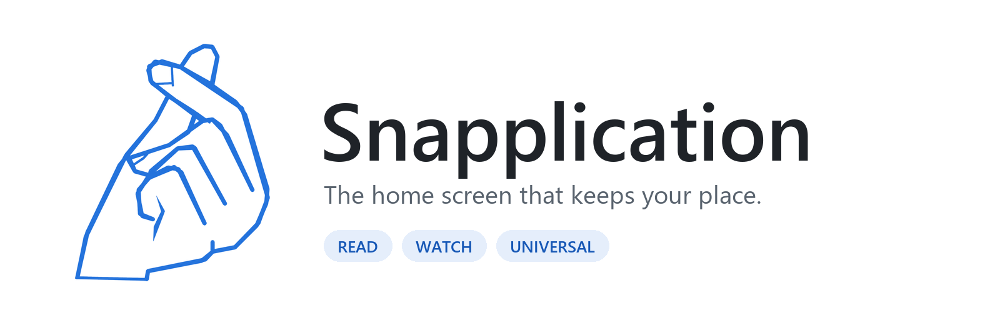
  </picture>
</p>

<p align="center">
  
  
  
  
  
</p>

<p align="center">
  <a href="#see-it-in-action">See it in action</a> ·
  <a href="#themes-and-layouts">Themes and layouts</a> ·
  <a href="#main-features">Features</a> ·
  <a href="#choose-your-edition">Editions</a> ·
  <a href="https://github.com/Mi-N-512/snapplication-launcher/releases/latest">Download</a> ·
  <a href="#get-started">Get started</a> ·
  <a href="#open-and-build-the-project">Build</a>
</p>

Snapplication puts the book or video you were last using in the centre of Home, with your favourite apps around it. Wake the phone and your place is already there, one tap from carrying on. The same launcher covers reading on e-paper, watching on a phone or TV, and turning a phone between the two.

Version 1.0 is free to [download from GitHub Releases](https://github.com/Mi-N-512/snapplication-launcher/releases/latest). It has also been [submitted to F-Droid](https://gitlab.com/fdroid/fdroiddata/-/merge_requests/54996) and will appear there once it's reviewed.

To get updates automatically, add it to [Obtainium](https://github.com/ImranR98/Obtainium), which installs straight from GitHub Releases. When it asks which APK to use, pick your edition.

<a href="https://apps.obtainium.imranr.dev/redirect?r=obtainium://add/https://github.com/Mi-N-512/snapplication-launcher"></a>

## See it in action

<p align="center"></p>

<p align="center"><b>Watch.</b> Pause a video in a supported player and go Home. The moment you stopped, and how far you got, wait in the centre. Tap it to carry on.</p>

<table>
  <tr>
    <td align="center" width="50%"></td>
    <td align="center" width="50%">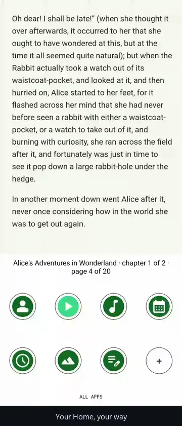</td>
  </tr>
  <tr>
    <td align="center"><b>Read.</b> Your book waits on Home. One tap opens it full screen.</td>
    <td align="center"><b>Make it yours.</b> Icon style and viewer layout change Home straight away.</td>
  </tr>
</table>

## Themes and layouts

Every screen below comes from the same build with a different combination of settings. Themes, icon styles, icon packs and viewer layouts can be mixed freely, and Read and Watch can each keep their own.

<table>
  <tr>
    <td align="center">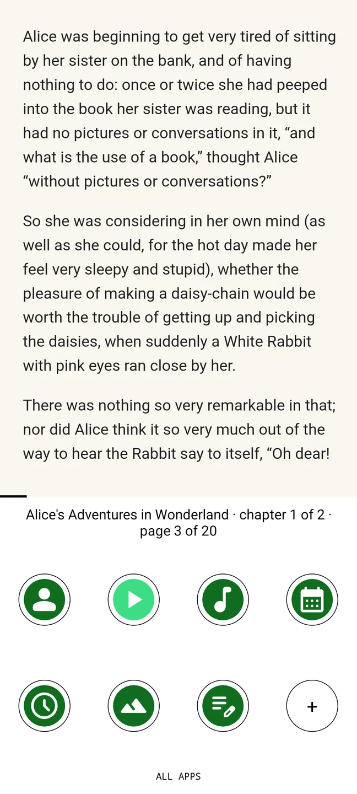</td>
    <td align="center">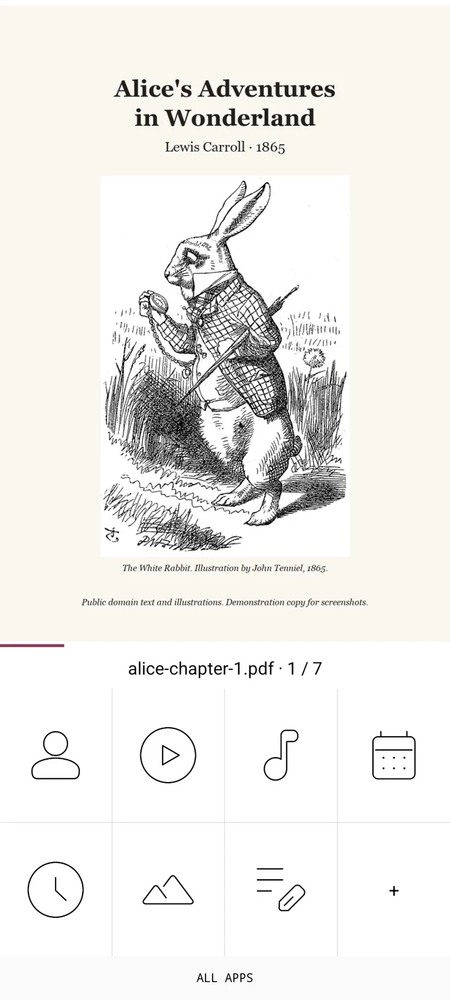</td>
    <td align="center">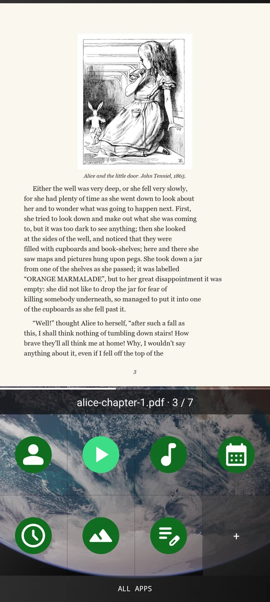</td>
  </tr>
  <tr>
    <td align="center"><sub>E-paper · Circles · clean + progress</sub></td>
    <td align="center"><sub>Light · Squares · standard</sub></td>
    <td align="center"><sub>Dark · wallpaper · Circles</sub></td>
  </tr>
  <tr>
    <td align="center">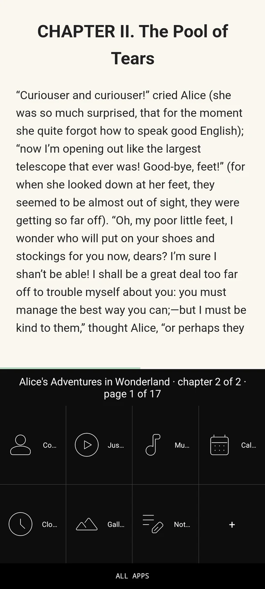</td>
    <td align="center">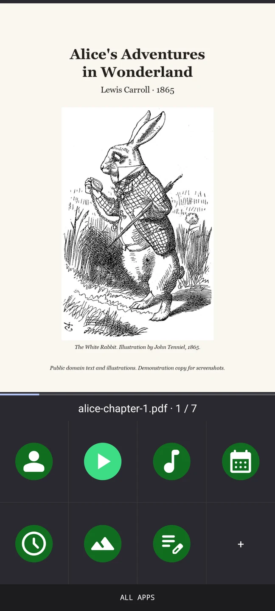</td>
    <td align="center">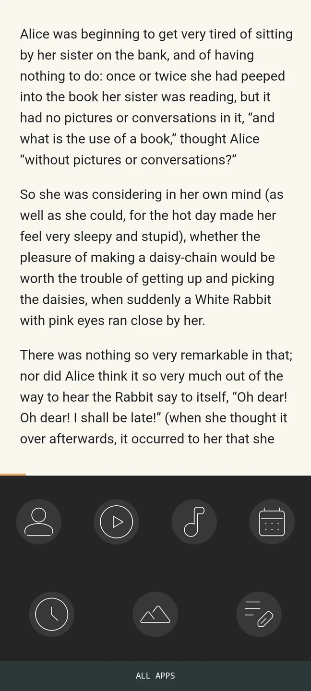</td>
  </tr>
  <tr>
    <td align="center"><sub>OLED Black · List with names</sub></td>
    <td align="center"><sub>Material You · Squares</sub></td>
    <td align="center"><sub>Custom colours · asymmetrical Circles</sub></td>
  </tr>
</table>

<table>
  <tr>
    <td align="center" width="50%">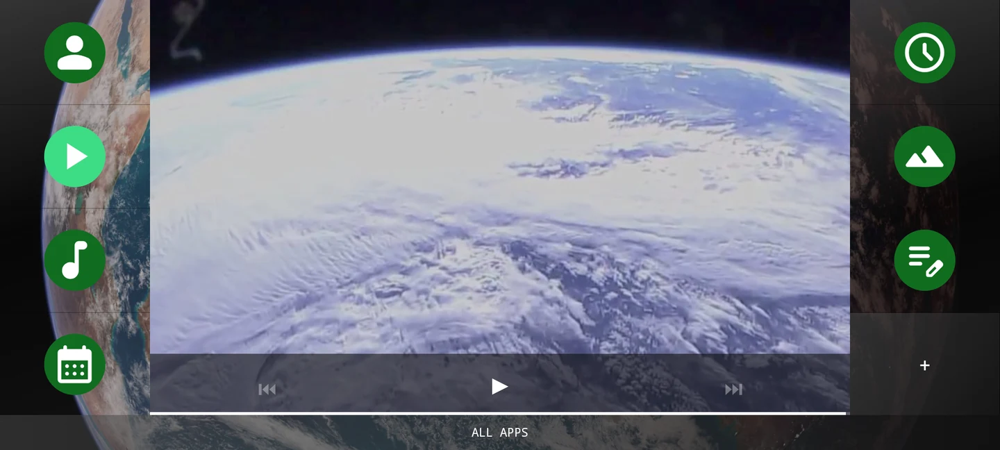</td>
    <td align="center" width="50%">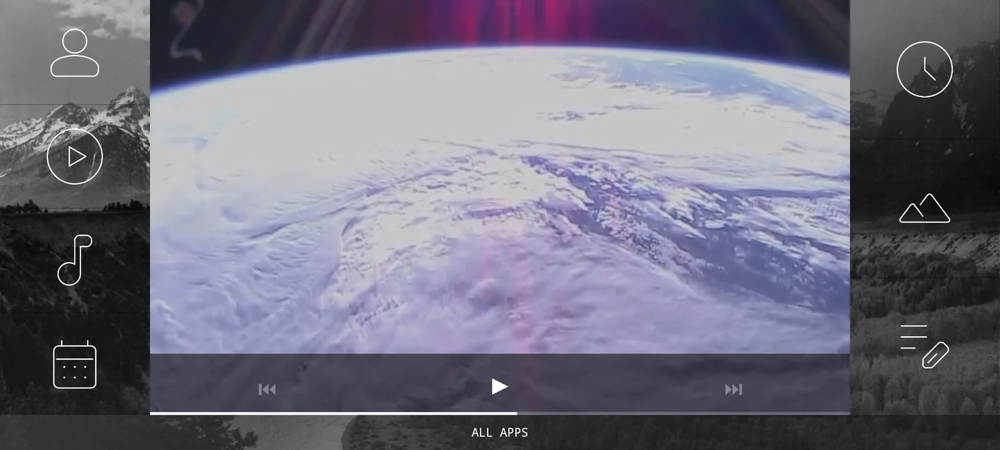</td>
  </tr>
  <tr>
    <td align="center"><sub>Watch · asymmetrical Squares · clean + progress</sub></td>
    <td align="center"><sub>Watch · standard layout with buttons</sub></td>
  </tr>
  <tr>
    <td align="center">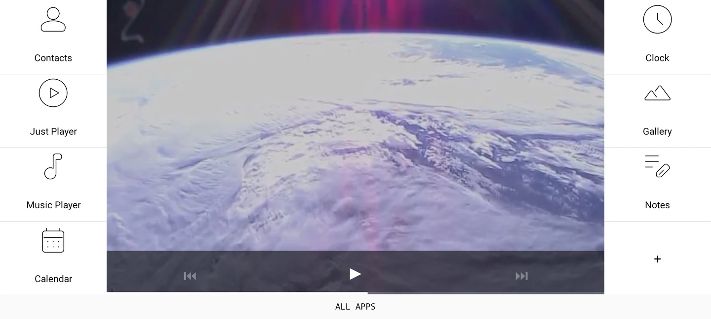</td>
    <td align="center">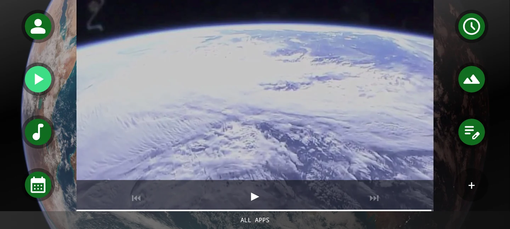</td>
  </tr>
  <tr>
    <td align="center"><sub>Light · List with names</sub></td>
    <td align="center"><sub>OLED Black · Circles · wallpaper</sub></td>
  </tr>
  <tr>
    <td align="center">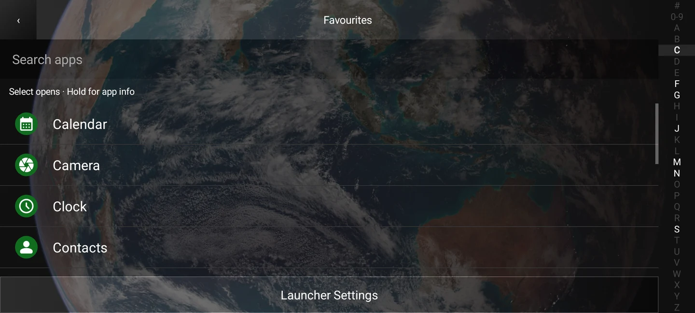</td>
    <td align="center">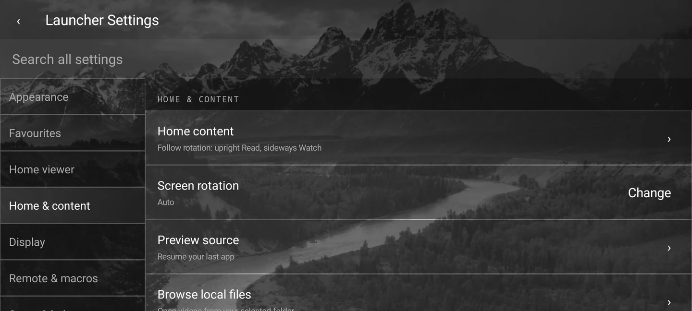</td>
  </tr>
  <tr>
    <td align="center"><sub>All Apps with search and A–Z rail</sub></td>
    <td align="center"><sub>Settings, grouped by category</sub></td>
  </tr>
</table>

<table>
  <tr>
    <td align="center">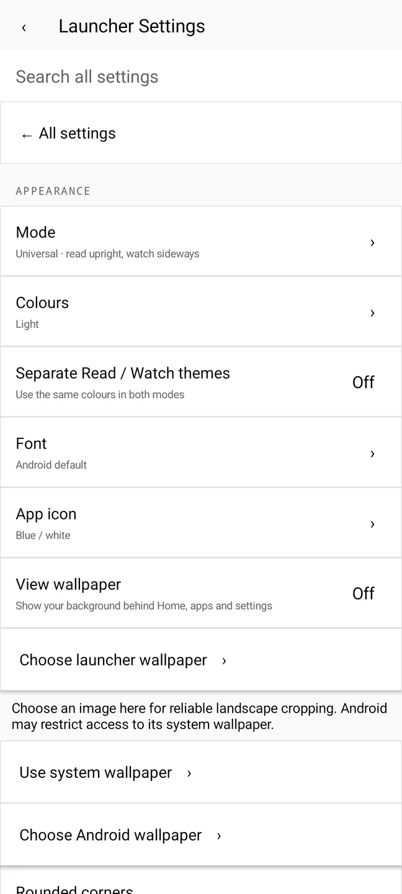</td>
    <td align="center">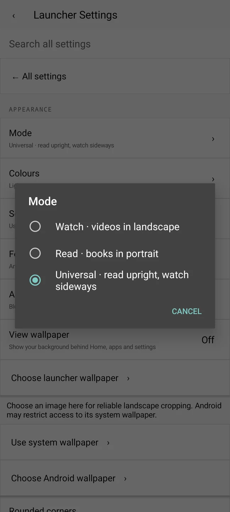</td>
    <td align="center"></td>
  </tr>
  <tr>
    <td align="center"><sub>Home viewer settings</sub></td>
    <td align="center"><sub>Mode: Watch, Read or Universal</sub></td>
    <td align="center"><sub>Universal: upright Read, sideways Watch</sub></td>
  </tr>
  <tr>
    <td align="center"></td>
    <td align="center" colspan="2"></td>
  </tr>
  <tr>
    <td align="center"><sub>Adding a favourite</sub></td>
    <td align="center" colspan="2"><sub>Your own videos: a five-second countdown to the next episode</sub></td>
  </tr>
</table>

<details>
<summary>About these captures</summary>

These are Android 15 emulator captures of the Universal edition, recorded at 60 frames per second. Read uses E-paper with symmetrical round keys; Watch uses a dark theme over a photograph with asymmetrical square blocks; both hide the viewer buttons and show a progress bar. Everything shown is free to reuse:

- The books are Chapters I and II of *Alice's Adventures in Wonderland* (Lewis Carroll, 1865) with John Tenniel's 1865 illustrations, both public domain, set as a small PDF and EPUB for these captures.
- The video is "Earth Views from the ISS" footage from NASA (public domain), trimmed and without its soundtrack.
- The wallpaper is Ansel Adams' *The Tetons and the Snake River* (1942), made for the US National Park Service and in the public domain.
- The line icons come from the open-source [Arcticons](https://github.com/Arcticons-Team/Arcticons) icon pack (GPL-3.0), white for Watch and black for Read. The apps are the open-source [Fossify](https://github.com/FossifyOrg) apps (GPL-3.0) and [Just Player](https://github.com/moneytoo/Player) (public domain, Unlicense), installed from F-Droid as examples. No apps or icon packs are bundled with Snapplication.

They show the built-in reader and player and one supported video app. Not every external app offers the same controls. The white dots in some clips are Android's "show taps" indicator.

</details>

## Main features

### Pick up where you left off

The centre can show a saved frame or reading page from a supported external app. Select it to reopen that app where you were; if the app allows it, playback resumes too. Read and Watch each remember their own last app.

Android and the other app still own that task, its playback buffer and its memory, so Snapplication can't freeze another app or guarantee an instant resume after Android closes it. **Keep apps ready** (Settings → Home & content) shows whether Android may close Snapplication or your app to save battery, and opens the switches that make it less likely, including your phone maker's own battery settings where it has them. Protected content, and apps that hide their page or player state, can limit previews and controls.

### Read and watch local content

Choose folders through Android's file picker. The built-in reader handles **EPUB, PDF, CBZ and images** and saves your place; other book formats open in a compatible installed reader. Local videos and supported direct media links play with your position saved.

Your own books and videos open **full screen** by default: Home shows a preview, one tap opens it across the whole screen, and Back returns Home. To read and watch between your favourites instead, set **Own books and videos** to **Inside Home** (Settings → Home viewer). Turn pages by tapping the page, swiping sideways or pressing a page key; picture sizing offers **Fit**, **Fill/crop** and **Stretch**.

Local video queues move on to the next episode once you pass the completion threshold you choose, for example 90%. When an episode plays to the end, a card counts down five seconds to the next one; tap it to start now or Cancel to stay. Other video apps only move to the next episode if they offer a Next control that Snapplication can press.

### Choose how the viewer looks

**Settings → Home viewer** controls the centre of Home in both Read and Watch. **Quick layout** offers Standard (buttons), Progress (buttons and a progress bar), Clean (no buttons) and Clean + progress, and each part can also be switched on its own.

With the buttons hidden, tap the centre to carry on: a video plays or pauses, a page turns (tap the left side to go back), and an app's saved preview reopens that app. The progress bar works for your own books and videos and for other apps' video previews, where it shows how far you had watched when you left.

### Make Home yours

Pick lists, square blocks or **Circles** (small round keys with space around them, like an old typewriter) under Settings → Favourites → **Icon style**, then choose the block count, symmetry, labels, wallpaper and theme. With **Separate Read / Watch themes** on, each mode keeps its own colours, icon pack, icon style and symmetry, so turning the phone can switch from a transparent Watch screen to an E-paper Read screen. The alphabet rail and search find everything else.

You can import your own TTF or OTF font and use any installed icon pack. Icon packs are chosen in Settings and are left out of the All Apps list. No icon pack or paid font is included.

### Remote buttons and recorded actions

The remote page shows a virtual remote. Pick an action on it, press the button on your physical remote, and that button now runs the action or a saved macro. Android reserves some keys, including Power on many devices, so not every physical button can be intercepted.

Macros can follow recorded screens or run coordinates on the current screen. The editor has timing, step editing, reference images and a rehearsal view. Image-matched actions can wait for a matching screen before tapping. Optional markers show taps during playback, and a running action has a Stop control and a saved result.

A reference screenshot alone does not grant permission to control protected Android screens. Current-screen coordinates can press the wrong place if the layout or orientation changes, so rehearse and check the position before assigning a remote button.

### Keep your setup

**Backup & restore** saves portable settings, favourites, remote assignments and macros, including their reference pictures, to a local file. Restore asks before replacing your setup. Permissions, folder access grants, media, preview frames, wallpapers and imported font files are not transferred.

Backups can contain recorded text and reference pictures. Keep them somewhere private.

## Why I wanted to create it

I wanted a launcher that shows where I left off and gets me back there quickly. A home screen should show the book or video I was using, with my apps around it, so I don't have to search through menus every time.

I also wanted the same idea to work in different situations: reading on an e-paper screen, watching on a phone connected to a TV, or rotating a phone between the two. Those devices need different controls and defaults, but they should still feel like the same application.

I intend to keep every feature free, with no advertising or feature paywalls, and to make the project something people can adapt to their own layouts and needs. Snapplication is licensed under GPL-3.0, so every copy and every modified version has to stay free and open source too.

## The design

The central Snapplication area is the largest part of Home, and favourites sit around it without headings. Layouts are angular by default, built from squares, rectangles and clear dividers, with options for people who prefer rounded corners.

Optional transparency (**View wallpaper** in Appearance) lets your wallpaper show through Home, All Apps and Settings, with neutral accents. Each theme suits a kind of screen: Light uses pastel pink, Dark and OLED Black use British racing green, Material You follows your Android colours, and E-paper favours contrast and static pages.

Touch, directional navigation and reading each get their own layout.

## Choose your edition

All four editions share the same core code. Each has its own app identity, so they can be installed side by side and keep separate settings.

| Edition | Android | Read / Watch | Best fit |
| --- | --- | --- | --- |
| [Universal](https://github.com/Mi-N-512/snapplication-launcher/releases/latest) | 8+ | Both | Phones, including older ones. Choose Watch, Read or Universal mode; Universal switches with rotation. |
| [Modern Universal](https://github.com/Mi-N-512/snapplication-launcher/releases/latest) | 11+ | Both | The same combined launcher with Android 11 as its minimum, including access to Android's still-screenshot API. |
| [E-reader](https://github.com/Mi-N-512/snapplication-launcher/releases/latest) | 8+ | Read only | A reading-focused interface with E-paper defaults and no Watch, remote or macro settings. |
| [TV](https://github.com/Mi-N-512/snapplication-launcher/releases/latest) | 8+ | Watch | Landscape, directional navigation, remote controls and an Android TV launcher entry. |

Automatic still-page capture needs **Android 11+**, an enabled accessibility service and a supported reading screen. Universal on Android 11+ can do this too; it isn't exclusive to Modern. On older systems you can still read local files and return to reader apps, but automatic still-page screenshots are unavailable.

Read mode does **not** use continuous screen recording. Watch previews use Android's screen-capture consent. Android TV launcher support does not mean every television, hub or remote has been certified.

## Get started

1. Download the APK for your edition from [the latest release](https://github.com/Mi-N-512/snapplication-launcher/releases/latest) and install it. Android may ask you to allow installs from your browser or files app. Check the file against `SHA256SUMS.txt` if you like. Keep the same edition when updating to retain its settings.
2. Choose **Watch**, **Read** or **Universal** where offered, then choose your theme. You can change the mode later under Settings → Appearance → **Mode** without repeating setup.
3. Open **All Apps** and enter its favourites editor. Tap apps to add them, then drag the preview icons into the order you want. An empty Home block opens this editor too.
4. In **Settings → Home & content**, choose whether Home returns to an app or shows content from a folder. Read and Watch remember separate choices.
5. Use **Settings → Setup & help → Status & repair** to review the default Home app and preview permissions. Android may ask for fresh Watch capture consent after an update or a stopped session.

## Permissions: what it needs and why

Android grants these when you install the app. You never see a prompt for them:

| Permission | Why Snapplication needs it |
| --- | --- |
| Internet | Only used when you tap **Open video link** in Watch mode and type in an HTTPS video address. There's no account, advertising or analytics. The E-reader edition doesn't ask for internet access. |
| Foreground service (screen capture) | Keeps the Watch preview service running while it saves a still frame, with Android's notification showing that it is active. |

You choose whether to allow the rest in Android's settings. Only the first is needed to use Snapplication as your launcher:

| Access | Needed? | What it is used for |
| --- | --- | --- |
| Default Home app | Yes | Opens Snapplication when you press Home. |
| Folder access (Android's file picker) | Only for local books and videos | Reads the folders you pick, and nothing else on your storage. |
| Accessibility service | Optional | Remote buttons, recorded actions, opening apps in landscape, and still reading-page previews on Android 11 and newer. |
| Screen sharing | Optional, Watch only | Saves a still frame of your video for Home and checks image-matched actions. Android asks each time and can end the session. |
| Notification access | Optional | Finds media apps that are playing, reads how far they have played, and sends them play, pause and next requests. |

Snapplication does not ask for your camera, microphone, contacts or location, and it does not need root. Preview pictures and macro reference data stay on the device. The launcher cannot get around secure screens, DRM or Android's permission decisions.

## Open and build the project

Open the folder containing `settings.gradle.kts` in Android Studio. Use **JDK 21** (JDK 17 also works), install Android SDK Platform 36 and let Gradle sync. Don't select a Java 25 runtime for this Gradle 8.13 project.

Choose `universalDebug`, `modernDebug`, `ereaderDebug` or `tvDebug` in **Build Variants**. The Gradle wrapper is included.

```powershell
# Build all four development APKs.
.\gradlew.bat :app:assembleDebug

# Build, lint and run unit tests for every edition.
.\scripts\verify.ps1
```

Gradle writes the APKs to `app/build/outputs/apk/`. Debug builds use a local debug key. Release builds are signed only when `.local/release-signing.properties` is present; that key is never committed. A build signed with a different key will not update an installation signed with the official release key.

Start reading the code at `MainActivity.kt`. Its header maps the screens to their helpers. Class comments explain responsibilities, key variables, real parent/child relationships and where changes belong. Run `scripts/verify.ps1` before calling a build ready; a compiled APK alone is not a passed test.

## Version 1.0 and what comes next

1.0 brings together everything above: Watch, Read and Universal modes, saved video frames with progress, the EPUB, PDF and comic reader, Home viewer layouts, per-mode themes and icon styles, remote buttons, recorded actions and backup/restore. All four editions pass build, lint and unit tests. The captures above come from an emulator.

Ideas I would like to include in future versions:

- **Provider plugins** so video and reading apps can send the episode or chapter you're on straight to Home.
- **A gaming mode** with its own layout for controllers, emulators and game launchers.
- **Recently read and watched**: a long press on the centre to switch between your last few books and videos.
- **TV and HDMI control**: HDMI-CEC so the television remote and power button work with Snapplication.
- **Better e-paper support**: vendor refresh modes for supported e-readers to reduce ghosting.
- **More languages**, with the interface ready for translation.

Suggestions and bug reports are welcome on the [issue tracker](https://github.com/Mi-N-512/snapplication-launcher/issues).

## Licence

Snapplication is free software: you can redistribute it and/or modify it under the terms of the [GNU General Public License version 3](LICENSE), as published by the Free Software Foundation. It is distributed in the hope that it will be useful, but without any warranty; see the licence for details.

Screenshots and demos use public domain media and open-source apps and icons, credited under [About these captures](#themes-and-layouts).
