<p align="center">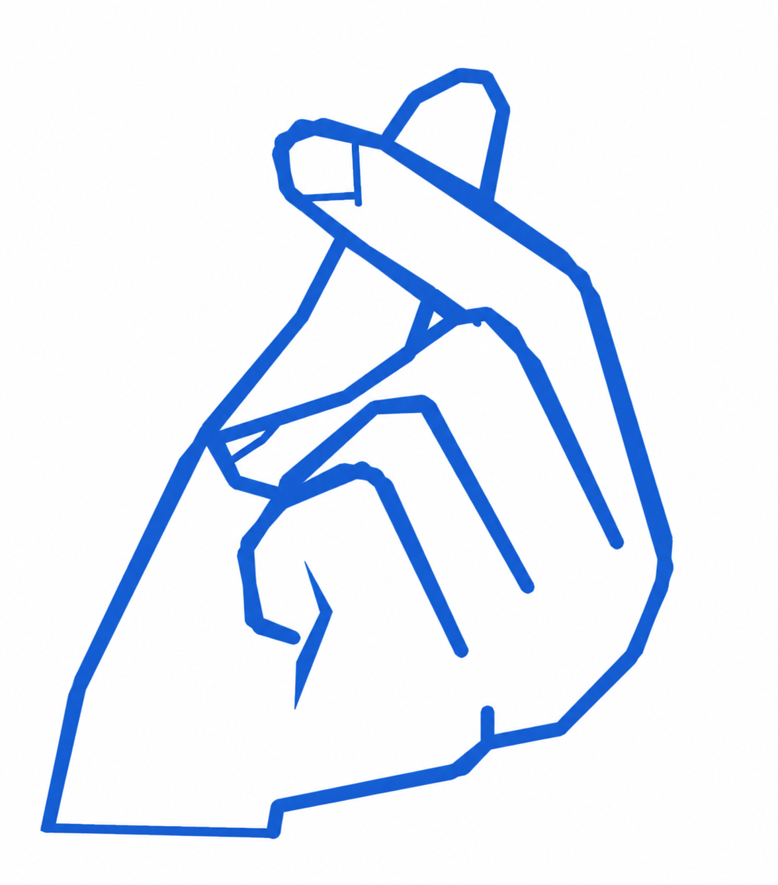</p>

# Snapplication · 0.99

**A home screen built around returning to what you were doing.**

Snapplication keeps your last reading page or video in the centre of Home, with your favourite apps around it. One launcher covers reading and watching on phones, e-readers and television setups.

0.99 is a private preview on the way to 1.0. These builds are for testing and are not a public store release.

[Features](#main-features) · [Choose your edition](#choose-your-edition) · [Download APKs](private-test-builds/) · [Get started](#get-started) · [Screenshots](#see-it-running) · [Build the project](#open-and-build-the-project)

<p align="center">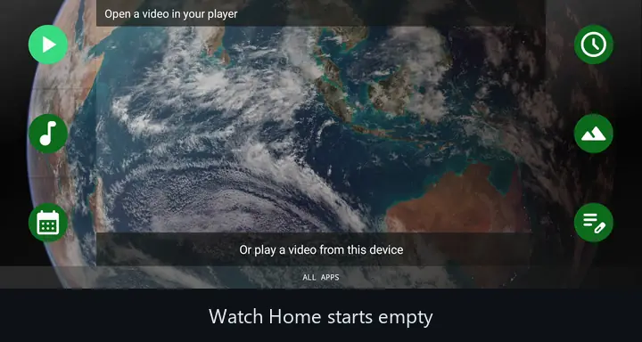</p>

<p align="center">Pause a video in any supported player, go Home, and the moment you stopped is waiting. Tap it to carry on.</p>

<p align="center">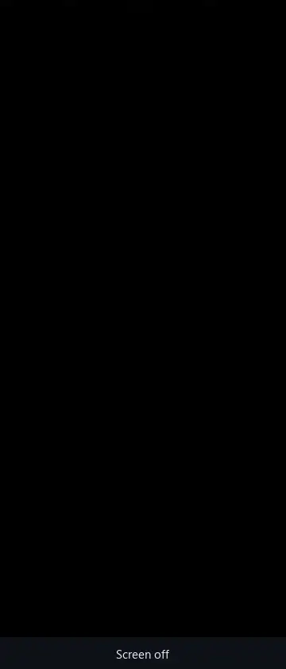</p>

<p align="center">Read mode in its own E-paper theme: your book is on Home, one tap away from full-screen reading.</p>

## Main features

### Pick up where you left off

The centre can show a saved frame or reading page from a supported external app. Select it to reopen that app where you were; if the app allows it, playback resumes too. Read and Watch each remember their own last app.

Android and the other app still own that task, its playback buffer and its memory. **Keep apps ready** (Settings → Home & content) shows whether Android may close Snapplication or your app to save battery, and opens the switches that prevent it, including Huawei's Battery page, where App launch lives. Snapplication can't freeze another app or guarantee an instant resume after Android closes it. Protected content, and apps that hide their page or player state, can limit previews and controls.

### Read and watch local content

Choose folders through Android's file picker. The built-in reader handles **EPUB, PDF, CBZ and images** and saves your place; other book formats open in a compatible installed reader. Local videos and supported direct media links play with your position saved. A thin bar along the bottom shows how far through the book or video you are.

Your own books and videos open **full screen** by default: Home shows a preview, one tap opens it across the whole screen, and Back returns Home. If you prefer to read and watch between your favourites, set **Own books and videos** to **Inside Home** (Settings → Home viewer).

Picture sizing offers **Fit**, **Fill/crop** and **Stretch**. Turn pages by tapping the page, swiping sideways or pressing a page key, and add Previous/Next buttons if you prefer them.

**Home viewer** (Settings → Home viewer) lets you choose how the centre of Home looks. **Quick layout** offers Standard (buttons), Progress (buttons and a progress bar), Clean (no buttons) and Clean + progress, and each part can also be switched on its own. With the buttons hidden, tap the centre to carry on: a video plays or pauses, a page turns (tap the left side to go back), and an app's saved preview reopens that app. The progress bar works for your own books and videos and for other apps' video previews, where it shows how far you had watched when you left.

Local video queues can move on to the next episode once you pass the completion threshold you choose (for example 90%). When you leave Home or turn the screen off past that point, the next file waits at its start and the finished one keeps its position. When an episode plays to the end, a card counts down five seconds to the next one; tap it to start now or Cancel to stay. Other video apps only move to the next episode if they offer a Next control that Snapplication can press.

### Make Home yours

Choose lists, square blocks or **Circles** (small round keys with space around them, like an old typewriter) under Settings → Favourites → **Icon style**; symmetrical or asymmetrical arrangements, favourite limits, labels, wallpaper and themes. Read and Watch can each keep their own theme and their own favourites, so turning the phone can switch from a transparent Watch screen to an E-paper Read screen. The alphabet rail and search help you find everything else.

You can import your own TTF or OTF font. Installed icon packs are optional; no icon pack or paid font is included.

### Remote buttons and recorded actions

The remote page shows a virtual remote. Pick an action on it, press the button on your physical remote, and that button now runs the action or a saved macro. Android reserves some keys, including Power on many devices, so not every physical button can be intercepted.

Macros can follow recorded screens or run coordinates on the current screen. The editor has timing, step editing, reference images and a rehearsal view. Image-matched actions can wait for a matching screen before tapping. Optional markers show taps during playback, and a running action has a Stop control and a saved result.

A reference screenshot alone does not grant permission to control protected Android screens. Current-screen coordinates can press the wrong place if the layout or orientation changes, so rehearse and check the position before assigning a remote button.

### Keep your setup

**Backup & restore** saves portable settings, favourites, remote assignments and macros, including their reference pictures, to a local file. Restore asks before replacing your setup. Permissions, folder access grants, media, preview frames, wallpapers and imported font files are not transferred.

Backups can contain recorded text and reference pictures. Keep them somewhere private.

## See it running

These are Android emulator captures (Universal edition, Android 15). All captures show the current build. Everything shown is free to reuse:

- The book is Chapter I of *Alice's Adventures in Wonderland* (Lewis Carroll, 1865) with John Tenniel's 1865 illustrations, both public domain, set as a small PDF for these captures.
- The video is "Earth Views from the ISS" footage from NASA (public domain), trimmed and without its soundtrack.
- The wallpaper is NASA Goddard's *Blue Marble 2007 East* (public domain).
- The app icons belong to the open-source [Fossify](https://github.com/FossifyOrg) apps (GPL-3.0) and [Just Player](https://github.com/moneytoo/Player) (public domain, Unlicense), installed from F-Droid as examples. No apps are bundled with Snapplication.

The captures show the built-in reader and player. They don't show that every external app supports the same controls.

| Read · Light · blocks | Read · E-paper · list |
| --- | --- |
| 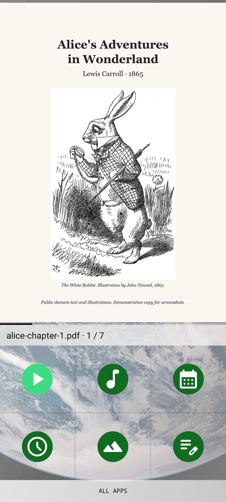 | 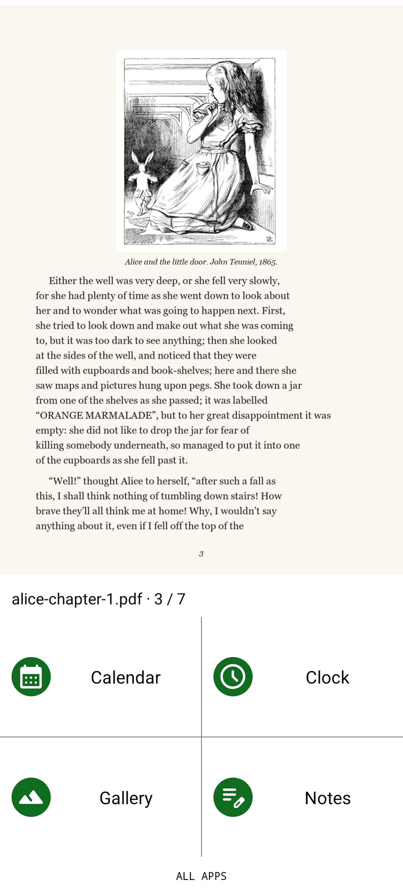 |

**Watch · Dark · blocks**

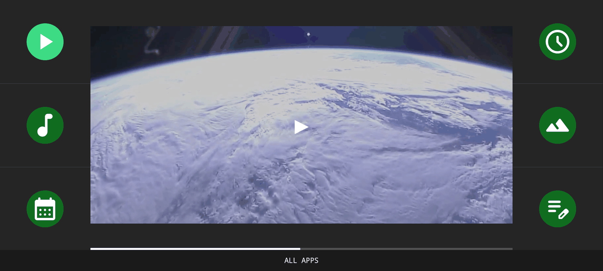

**Watch · OLED Black · list**

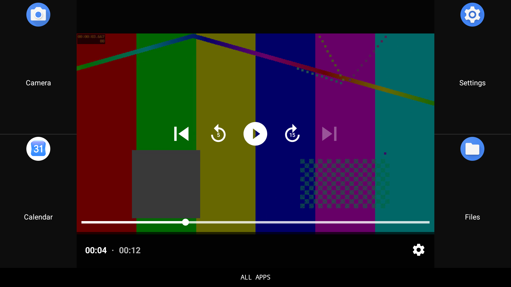

**Transparent Home and All Apps**

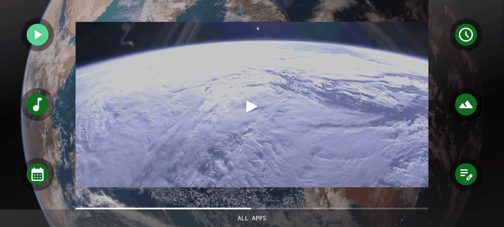
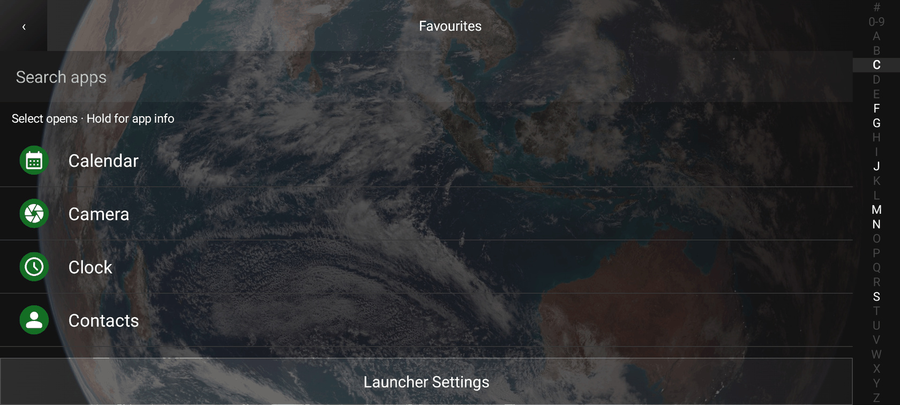

**Settings · Light, Dark and transparent**

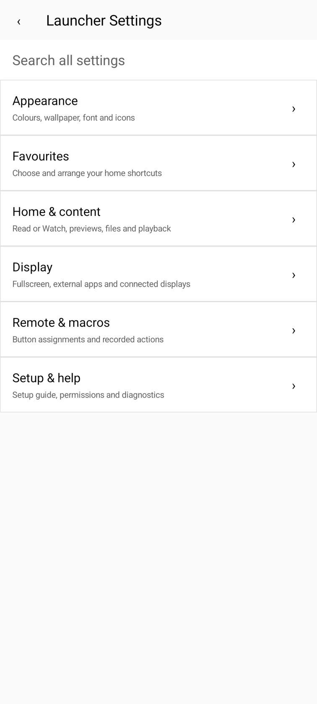
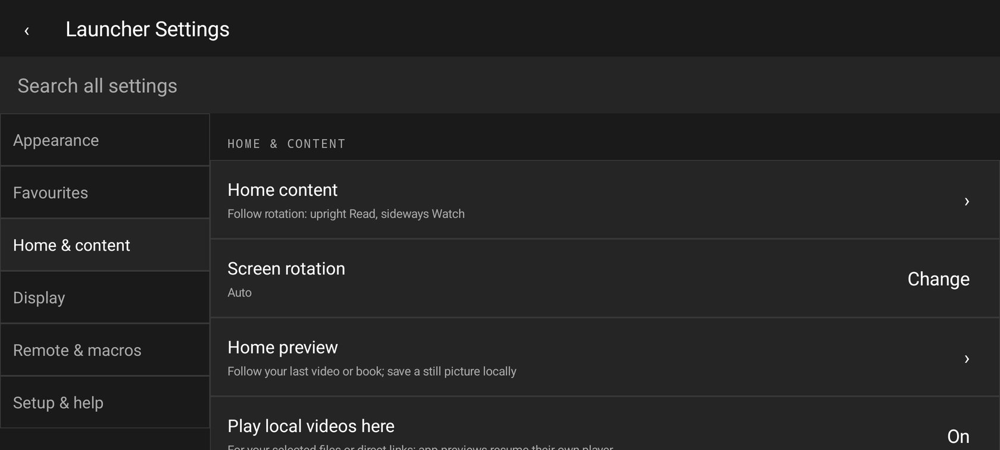
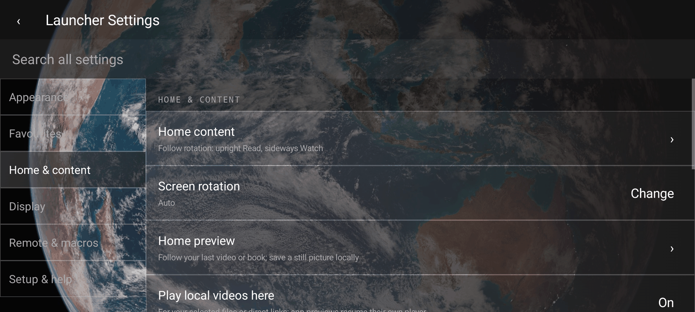

### In motion

| Turn sideways to watch | Next episode countdown | Adding a favourite |
| --- | --- | --- |
| 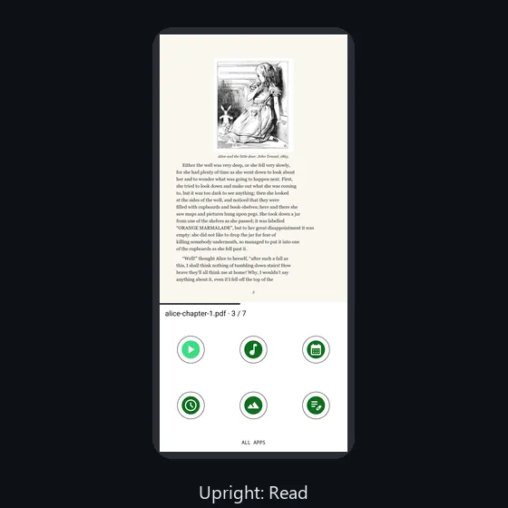 | 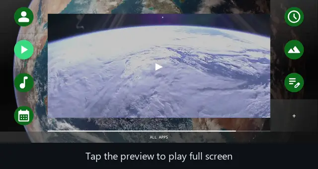 | 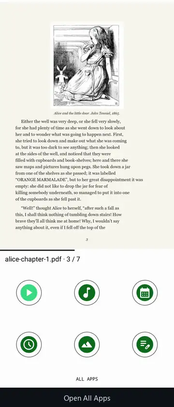 |

Read and Watch use separate themes here: Watch shows the wallpaper with square blocks, Read uses E-paper with Circles. The white dots in some clips are Android's "show taps" indicator.

## Why I wanted to create it

I wanted a launcher that shows where I left off and gets me back there quickly. A home screen should show the book or video I was using, with my apps around it, so I don't have to search through menus every time.

I also wanted the same idea to work in different situations: reading on an e-paper screen, watching on a phone connected to a TV, or rotating a phone between the two. Those devices need different controls and defaults, but they should still feel like the same application.

I intend to keep every feature free, with no advertising or feature paywalls, and to make the project something people can adapt to their own layouts and needs. A distribution licence still needs to be chosen before public release.

## The design

The central Snapplication area is the largest part of Home, and favourites sit around it without headings. Layouts are angular by default, built from squares, rectangles and clear dividers, with options for people who prefer rounded corners.

Optional transparency (**View wallpaper** in Appearance) lets your wallpaper show through Home, All Apps and Settings, with neutral accents. Each theme suits a kind of screen: Light uses pastel pink, Dark and OLED Black use British racing green, and E-paper favours contrast and static pages.

Touch, directional navigation and reading each get their own layout. Phone setup can follow rotation or keep the content mode you chose.

## Choose your edition

All four editions share the same core code. Each has its own app identity, so they can be installed side by side and keep separate settings.

| Edition | Android | Read / Watch | Best fit |
| --- | --- | --- | --- |
| [Universal](private-test-builds/snapplication-universal-debug.apk) | 8+ | Both | Existing installations and older phones. Phone setup can switch Read/Watch with rotation. |
| [Modern Universal](private-test-builds/snapplication-modern-debug.apk) | 11+ | Both | The same combined launcher with Android 11 as its minimum, including access to Android's still-screenshot API. |
| [E-reader](private-test-builds/snapplication-ereader-debug.apk) | 8+ | Read only | A reading-focused interface with E-paper defaults and no Watch, remote or macro settings. |
| [TV](private-test-builds/snapplication-tv-debug.apk) | 8+ | Watch | Landscape, directional navigation, remote controls and an Android TV launcher entry. |

Automatic still-page capture needs **Android 11+**, an enabled accessibility service and a supported reading screen. Universal on Android 11+ can do this too; it isn't exclusive to Modern. On older systems you can still read local files and return to reader apps, but automatic still-page screenshots are unavailable.

Read mode does **not** use continuous screen recording. Watch previews use Android's screen-capture consent. Android TV launcher support does not mean every television, hub or remote has been certified.

## Get started

1. Open the [private test builds](private-test-builds/) while signed in to the repository. Select your APK and choose **Download raw file**, then install it on a compatible device. Keep the same edition when updating to retain its settings.
2. Choose **Watch**, **Read** or **Universal** where offered (you can change it later under Settings → Appearance → **Mode**), then choose your theme. Follow the guided introduction and enable only the features you want.
3. Open **All Apps** and enter its favourites editor. Tap apps to add them, then drag the preview icons into the order you want. An empty Home block opens this editor too.
4. In **Settings → Home & content**, choose whether Home returns to an app or shows content from a folder. Read and Watch remember separate choices. Built-in playback and reading are optional.
5. Use **Settings → Setup & help → Status & repair** to review the default Home app and preview permissions. Android may ask for fresh Watch capture consent after an update or a stopped session.

In Universal mode, **Follow rotation** can choose Read upright and Watch sideways. You can also keep Read or Watch selected while changing orientation. The dedicated editions keep their intended content mode.

## Permissions: what it needs and why

Android grants these when you install the app. You never see a prompt for them:

| Permission | Why Snapplication needs it |
| --- | --- |
| Internet | Plays direct HTTPS video links you enter. Snapplication has no account, advertising or analytics. |
| Foreground service (screen capture) | Keeps the Watch preview service running while it saves a still frame, with Android's notification showing that it is active. |

You choose whether to allow the rest in Android's settings. Only the first is needed to use Snapplication as your launcher:

| Access | Needed? | What it is used for |
| --- | --- | --- |
| Default Home app | Yes | Opens Snapplication when you press Home. |
| Folder access (Android's file picker) | Only for local books and videos | Reads the folders you pick, and nothing else on your storage. |
| Accessibility service | Optional | Remote buttons, recorded actions, opening apps in landscape, and still reading-page previews on Android 11 and newer. |
| Screen sharing | Optional, Watch only | Saves a still frame of your video for Home and checks image-matched actions. Android asks each time and can end the session. |
| Notification access | Optional | Finds media apps that are playing and sends them play, pause and next requests. |

Snapplication does not ask for your camera, microphone, contacts or location, and it does not need root. Preview pictures and macro reference data stay on the device. The launcher cannot get around secure screens, DRM or Android's permission decisions.

## Open and build the project

Open the folder containing `settings.gradle.kts` in Android Studio. Use **JDK 21** (JDK 17 also works), install Android SDK Platform 36 and let Gradle sync. Don't select a Java 25 runtime for this Gradle 8.13 project.

Choose `universalDebug`, `modernDebug`, `ereaderDebug` or `tvDebug` in **Build Variants**. The Gradle wrapper is included.

```powershell
# Build all four development APKs.
.\gradlew.bat :app:assembleDebug

# Build, lint and run unit tests for every edition.
.\scripts\verify.ps1
```

Gradle writes the APKs to `app/build/outputs/apk/`. These private builds use a local debug signing key that is never committed. A build signed elsewhere with a different key will not update an installation signed with the original key.

Start reading the code at `MainActivity.kt`. Its header maps the screens to their helpers. Class comments explain responsibilities, key variables, real parent/child relationships and where changes belong. Run `scripts/verify.ps1` before calling a build ready; a compiled APK alone is not a passed test.

## On the way to 1.0

0.99 includes the combined Read/Watch setup, simplified settings, rotation support, preview repair tools, macro editing, backup/restore and the comment rewrite. All four editions pass build, lint and unit tests. The screenshots above come from an emulator and don't replace physical e-paper, HDMI and remote testing.

Before public 1.0, the physical-device regression pass needs finishing, a distribution licence needs choosing, and release signing and distribution need setting up. Provider plugins and a gaming mode remain future work. There is no public GitHub Release, Play Store or F-Droid listing for this build.
